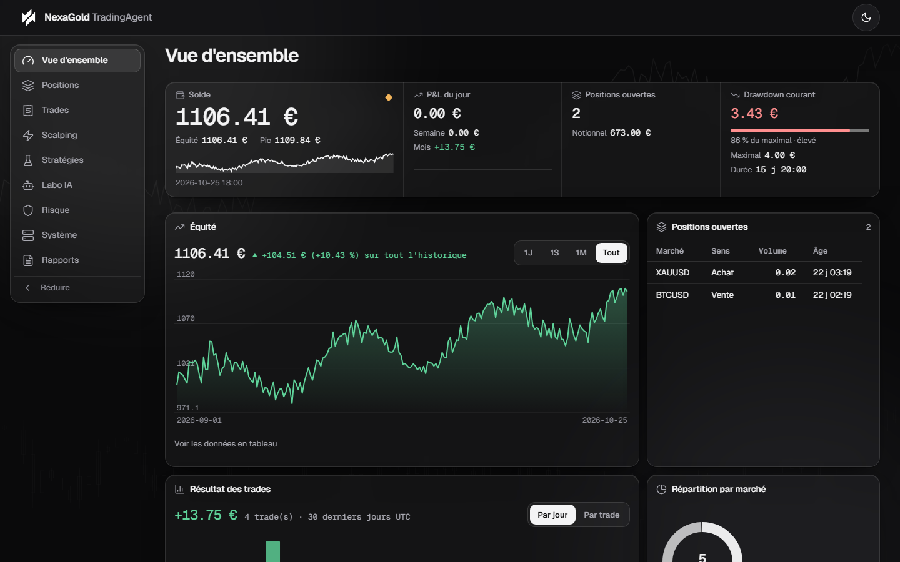
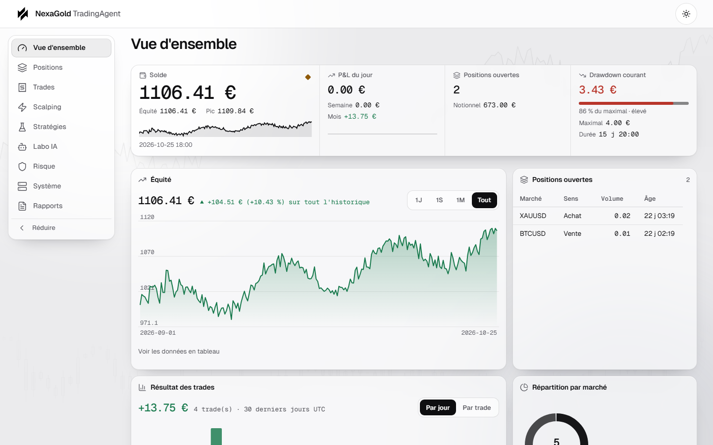
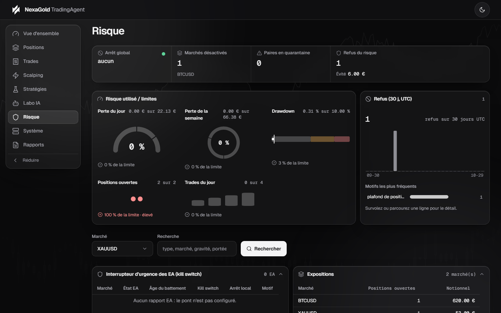
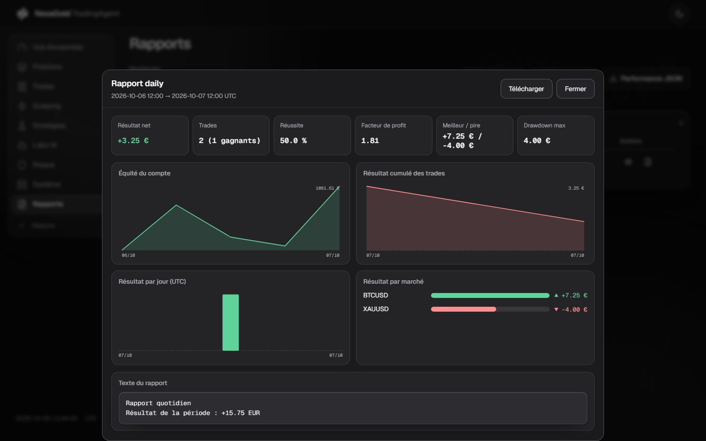
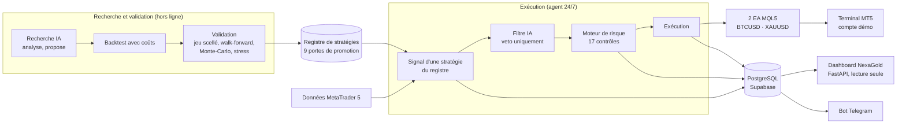

<p align="center">
  
</p>

<h1 align="center">TradingAgent</h1>

<p align="center">
  Plateforme de trading algorithmique <strong>XAUUSD + BTCUSD</strong> avec tableau de bord <em>NexaGold</em> :<br>
  l'IA recherche et améliore les stratégies, elle ne décide pas de chaque trade.
</p>

<p align="center">
  <a href="https://github.com/nagoloumdaniel/TradingAgent/actions/workflows/ci.yml"></a>
  <a href="LICENSE"></a>
  
  
  <a href="https://nexagold.vercel.app/"></a>
</p>

> **Projet en cours, démo uniquement.** TradingAgent est une pré-production : il tourne sur un
> **compte de démonstration MetaTrader 5**. Le mode réel n'est pas activé et le dossier de
> conformité est **NON VÉRIFIÉ**. Aucun des backtests de référence ne franchit le seuil de
> rentabilité exigé par le projet (voir [Résultats et limites](#résultats-et-limites)).
> Ce dépôt n'est pas un conseil en investissement et ne promet aucun gain :
> lisez [`DISCLAIMER.md`](DISCLAIMER.md).



*Vue d'ensemble du tableau de bord. Les chiffres de cette capture sont des **données de
démonstration fictives**, générées par `scripts/preview_dashboard.py --demo` sur une base
jetable : ils ne représentent aucun résultat réel.*

<details>
<summary>Autres captures : thème clair, page Risque, rapport (données de démonstration, pas des résultats de trading)</summary>





</details>

## Sommaire

[Ce que ça fait](#ce-que-ça-fait-et-ne-fait-pas) · [Architecture](#architecture) ·
[Pipeline](#du-signal-à-lordre) · [Stack](#stack) · [Résultats et limites](#résultats-et-limites) ·
[Installation](#installation) · [Commandes](#commandes) · [Documentation](#documentation) ·
[Contribuer](#contribuer-et-transparence-sur-lassistance-ia)

## Ce que ça fait (et ne fait pas)

**Ce que ça fait**

- **Recherche de stratégies assistée par IA** : analyse des pertes, détection de dégradation,
  propositions d'amélioration. Rien de cela n'ouvre un ordre.
- **Backtest avec coûts** (spread, slippage, latence) et **validation anti-surapprentissage** :
  jeu scellé par jeton, walk-forward, Monte-Carlo, tests de stress.
- **Registre de stratégies versionné** : une stratégie n'atteint le mode réel qu'après neuf
  portes de promotion, et une version publiée n'est jamais modifiée.
- **Moteur de risque** : 17 contrôles (perte jour/semaine, drawdown, positions, exposition,
  spread, marge, cooldown…) ; chaque refus est persisté avec son motif.
- **Exécution MetaTrader 5** protégée par **deux Expert Advisors MQL5** (un par marché) et un
  arrêt d'urgence côté serveur.
- **Tableau de bord web en lecture seule** (10 pages, temps réel par SSE) et **bot Telegram**.

**Ce que ça ne fait pas**

- Il **ne garantit aucune rentabilité** et n'a pas démontré d'avantage statistique.
- Il **ne trade pas en réel** : le mode réel n'est pas activé.
- Il **ne laisse pas l'IA décider** : elle ne peut que rejeter un signal, jamais en créer un,
  augmenter une taille ni desserrer un stop.
- Il **ne fonctionne pas sous Linux ou macOS** : l'exécution passe par le terminal
  MetaTrader 5 et son paquet Python, disponibles sous Windows uniquement.
- Il n'est **pas prêt pour la production**.

## Architecture



Six couches, aucune ne contournant les protections d'une autre :

| Couche | Rôle | Ce qu'elle ne peut pas faire |
|---|---|---|
| Recherche IA | chercher, analyser, **proposer** | passer un ordre, modifier un stop, promouvoir |
| Backtest & validation | mesurer, éprouver la robustesse | décider seule d'une promotion |
| Risk engine | limiter, refuser, réduire | être contourné par une stratégie |
| Trading engine | exécuter la stratégie **validée** | exécuter une version non promue |
| Expert Advisors MT5 | exécuter, surveiller, protéger | décider d'un trade |
| Analytics & web | mesurer, observer | recalculer un chiffre critique |

La correspondance section par section avec le cahier des charges v3 est dans
[`docs/v3/ARCHITECTURE.md`](docs/v3/ARCHITECTURE.md), l'état d'avancement dans
[`docs/v3/STATUS.md`](docs/v3/STATUS.md).

## Du signal à l'ordre

Ordre des opérations dans `src/tradingagent/runtime/pipeline.py`, aucune n'étant facultative :

1. **Recherche → registre** : une stratégie candidate doit franchir les neuf portes
   (`backtest`, `costs`, `walk_forward`, `out_of_sample`, `monte_carlo`, `stress`,
   `parameter_robustness`, `paper`, `risk`) pour être promue. Un échec ultérieur révoque un
   succès antérieur.
2. **Signal** : la stratégie, à son niveau de l'échelle (signal, démo, réel), produit un signal ;
   il est persisté.
3. **Filtre IA** : il voit le candidat et ne peut que le **bloquer**.
4. **Moteur de risque** : 17 contrôles ; la décision est écrite, refus compris.
5. **Notification** Telegram, puis, dans un mode qui exécute, **envoi de l'ordre** et vérification
   de la réponse du courtier. Un ordre accepté sans stop-loss est refermé aussitôt et signalé.
6. Les **EA** surveillent, protègent et déclenchent un arrêt local si le backend se tait.

Invariants vérifiés par les tests (notamment `tests/test_architecture.py`) :

- Seul `risk` importe `execution` (exception : la racine de composition `tradingagent.app`).
- Aucun module de production n'importe `backtest` ni `research`.
- L'IA ne peut que rejeter un signal.
- Toute date est en UTC ; les datetimes naïfs sont interdits.
- Toute décision est persistée avec son motif, refus compris.
- Le dashboard ne calcule aucun indicateur et ne peut pas écrire en base.
- Aucun secret dans le dépôt, seulement le gabarit [`.env.example`](.env.example).

## Stack

| Domaine | Technologies |
|---|---|
| Langage, outillage | Python 3.12, [uv](https://docs.astral.sh/uv/) (`uv.lock`) |
| Web | FastAPI, Uvicorn, Jinja2, SSE |
| Données | SQLAlchemy 2, Alembic (9 migrations, 23 tables), PostgreSQL hébergé sur Supabase |
| Courtage | MetaTrader 5 (paquet Python `MetaTrader5`, **Windows uniquement**) et 2 EA MQL5 |
| Notifications | python-telegram-bot |
| IA | SDK `anthropic` (le LLM est optionnel : sans clé, l'analyse déterministe sort quand même) |
| Qualité | pytest, ruff, mypy, pre-commit, detect-secrets, GitHub Actions, Dependabot |

Trois stratégies sont publiées dans `config/strategies/` : `vwap_pullback`, `trend_breakout` et
`witness` (plusieurs versions chacune).

## Résultats et limites

Cette section est volontairement sans fard. Le seuil exigé par le projet est un **profit factor
net de 1,20** ; **aucune mesure de référence ne l'atteint de façon fiable**.

| Mesure | Résultat | Lecture |
|---|---|---|
| `vwap_pullback`, validation, BTCUSD (205 trades) et XAUUSD (231 trades) | profit factor net **0,6818** et **0,5454** | très en dessous de 1,20 et de 1 |
| `vwap_pullback@1.3.0`, BTCUSD, fenêtre de validation | **1,0275** (170 trades) | semblait prometteur |
| `vwap_pullback@1.3.0`, BTCUSD, **jeu scellé** (154 trades) | **0,6909**, −370,13 € | l'avantage apparent ne s'est pas confirmé hors échantillon |
| `vwap_pullback@1.4.0`, BTCUSD, entraînement + validation (123 trades) | **0,9441** ; 1,3916 sur la seule validation (35 trades) | le filtre a été trouvé en examinant 164 tranches des mêmes données ; jeu scellé **non ouvert** |
| Compte démo MT5, 22 trades clôturés du 13 au 28/10/2026 | **+14,90 €**, profit factor 1,08 | **non significatif statistiquement** |

À retenir :

- La stratégie `vwap_pullback@1.4.0` est référencée pour BTCUSD dans `config/agent.yaml`
  **sur le compte démo**, par dérogation explicite de l'opérateur, en connaissance de ces
  chiffres. Ce n'est pas une validation.
- Sur l'or réel, aucun candidat ne survit à la correction du taux de fausses découvertes
  (voir [`docs/v3/STATUS.md`](docs/v3/STATUS.md)) : c'est le résultat honnête, pas un échec de
  mesure.
- Les performances passées ne garantissent aucun résultat futur. Le détail des mesures est dans
  [`docs/research/`](docs/research/README.md) et
  [`docs/research/2026-10-28-diagnostic-pertes-demo.md`](docs/research/2026-10-28-diagnostic-pertes-demo.md)
  (ce diagnostic précède l'activation de la 1.4.0 en démo : [`config/agent.yaml`](config/agent.yaml)
  fait foi pour l'état courant).

**Statut du projet** : en cours, pré-production. 175 commits sur `main` depuis le 3 octobre 2026 ;
3 stratégies, 2 EA MQL5, 17 contrôles de risque, 9 portes de promotion, 10 pages web.
Dernier rapport de vérification complet
([`docs/reports/2026-10-10-verification-finale.md`](docs/reports/2026-10-10-verification-finale.md)) :
2789 tests passés, 9 ignorés, `ruff check` et `mypy` propres. Ces chiffres datent de ce rapport
et ne sont pas rejoués à chaque modification de la documentation.

## Installation

Prérequis : **Windows**, [uv](https://docs.astral.sh/uv/) (`winget install --id astral-sh.uv -e`)
et le terminal MetaTrader 5 (la documentation d'installation part de l'espace client Deriv).
Un guide pas à pas est dans [`docs/operations/installation.md`](docs/operations/installation.md).

```powershell
pwsh -File scripts/install_windows.ps1 -WhatIf   # simulation
pwsh -File scripts/install_windows.ps1           # installation reproductible depuis uv.lock
Copy-Item .env.example .env                      # puis renseigner les clés (jamais versionné)
uv run tradingagent doctor                       # quelles clés manquent, et où les trouver
uv run tradingagent status                       # vérifie l'accès à la base
```

`scripts/install_deps.ps1` ajoute les hooks pre-commit sur un poste de développement.
La configuration complète (variables d'environnement, base, EA) est décrite dans
[`docs/operations/configuration.md`](docs/operations/configuration.md).

Pour **voir le tableau de bord sans base ni courtier**, une base jetable avec données fictives suffit :

```powershell
uv run python scripts/preview_dashboard.py --demo   # http://127.0.0.1:8799
```

## Commandes

```bash
# Qualité
uv run pytest -q             # tests
uv run ruff check .          # lint
uv run ruff format .         # format
uv run mypy                  # typage

# Exécution
uv run tradingagent-run                      # l'agent (boucle complète, 24/7)
uv run tradingagent-run --once               # un seul cycle, pour vérifier
uv run tradingagent-run --cycles 3           # nombre borné de cycles

# Monitoring (lecture seule)
uv run tradingagent-web                      # http://127.0.0.1:8787

# Contrôle
uv run tradingagent doctor                   # quelles clés manquent, et où les trouver
uv run tradingagent status                   # arrêt d'urgence
uv run tradingagent halt --reason "..."      # arrêt côté serveur
uv run tradingagent resume --reason "..."    # reprise

# Stratégies
uv run python -m tradingagent.registry.cli registry-status
uv run python -m tradingagent.registry.cli registry-validate --ref ... --market ... --stage risk
uv run python -m tradingagent.registry.cli registry-promote --ref ... --market ... --actor ...

# Recherche
uv run python scripts/backtest/run_campaign.py --datasets docs/research/datasets
uv run python scripts/paper_campaign.py      # état de la campagne de paper trading
```

## Expert Advisors

Deux EA MQL5 (`mt5/Experts/TradingAgent/`) tournent dans le terminal : un par marché. Ils
exécutent les ordres autorisés par le backend, vérifient les protections, déclenchent leur
arrêt local si le backend se tait, et remontent chaque événement. La compilation est
documentée dans [`docs/ea/README.md`](docs/ea/README.md) ; le protocole d'échange dans
[`docs/ea/protocole-pont.md`](docs/ea/protocole-pont.md).

Le pont entre l'agent et les EA passe par `EA_FILES_DIR`, à pointer sur
`%APPDATA%\MetaQuotes\Terminal\<instance>\MQL5\Files\TradingAgent`. Sans cette variable,
l'agent tourne sans EA — c'est un état valide.

## Documentation

| Besoin | Commande | Documentation |
|---|---|---|
| Installer | `pwsh -File scripts/install_windows.ps1` | [installation](docs/operations/installation.md) |
| Configurer | `.env` | [configuration](docs/operations/configuration.md) |
| Enregistrer le service | `pwsh -File scripts/register_service.ps1` | [exploitation](docs/operations/exploitation.md) |
| Démarrer tout seul au logon (poste, sans serveur) | `pwsh -File scripts/install_autostart.ps1 -WithDashboard` | [démarrage automatique](docs/operations/demarrage-automatique.md) |
| Superviser l'agent (terminal, agent, dashboard) | `pwsh -File scripts/supervise_agent.ps1 -Status` | [démarrage automatique](docs/operations/demarrage-automatique.md) |
| Surveiller | `pwsh -File scripts/check_health.ps1 -CheckTask` | [exploitation](docs/operations/exploitation.md) |
| Sauvegarder | `pwsh -File scripts/backup.ps1` | [sauvegarde et restauration](docs/operations/backup-restore.md) |
| Restaurer | `pwsh -File scripts/restore.ps1 -BackupFile ... -Force` | [sauvegarde et restauration](docs/operations/backup-restore.md) |
| Arrêter d'urgence | `/emergency_stop` ou `uv run tradingagent halt` | [arrêt d'urgence](docs/operations/arret-urgence.md) |
| Campagne paper | `uv run python scripts/paper_campaign.py` | [campagne paper](docs/operations/campagne-paper.md) |
| Réagir à un incident | — | [incidents](docs/operations/incidents.md) |
| Utiliser le bot | `/help` | [commandes Telegram](docs/operations/commandes-telegram.md) |
| Lire le dashboard | `uv run tradingagent-web` | [web](docs/web/README.md) · [design](docs/web/DESIGN.md) |
| Cycle de vie des stratégies | `python -m tradingagent.registry.cli` | [registre](docs/registry/README.md) |
| Amélioration IA | passage quotidien automatique | [AI Lab](docs/ai_lab/README.md) |
| Intégration continue | — | [CI](docs/operations/ci.md) |
| Conformité du mode réel | — | [dossier de conformité](docs/legal/2026-10-07-conformite-mode-reel.md) (**NON VÉRIFIÉ**) |

Le projet est né d'un cahier des charges initial ([`CAHIER_DES_CHARGES.md`](CAHIER_DES_CHARGES.md),
signaux Deriv notifiés sur Telegram) puis a été étendu par le cahier **v3**
« AI Scalping Trading System ». L'ordre de développement est dans [`ROADMAP.md`](ROADMAP.md).
`CLAUDE.md` est un fichier de contexte pour l'assistant de code ; il n'est pas une
documentation de référence.

## Liens

- Site : <https://nexagold.vercel.app/> (source dans [`site/`](site/))
- Dépôt : <https://github.com/nagoloumdaniel/TradingAgent>
- Signaler un bug ou proposer une idée : [issues](https://github.com/nagoloumdaniel/TradingAgent/issues)

## Contribuer et transparence sur l'assistance IA

Les contributions sont bienvenues : lisez [`CONTRIBUTING.md`](CONTRIBUTING.md) (branche
`feat|fix|refactor|test|docs/<slug>`, tests, aucun secret, Conventional Commits) et le
[code de conduite](CODE_OF_CONDUCT.md). Faille de sécurité : [`SECURITY.md`](SECURITY.md).

Le projet est écrit et dirigé par **Daniel Nagoloum Talla**. Une partie du code, des tests et de
la documentation a été produite **avec l'assistance de modèles Claude (Anthropic)** : les commits
concernés portent un trailer `Co-Authored-By`.

## Licence et avertissement

Code sous licence [MIT](LICENSE), © 2026 Daniel Nagoloum Talla. Le trading à effet de levier
comporte un risque élevé de perte, pouvant dépasser le capital engagé : lisez
[`DISCLAIMER.md`](DISCLAIMER.md). Ce dépôt est un projet logiciel, pas un conseil en
investissement.
